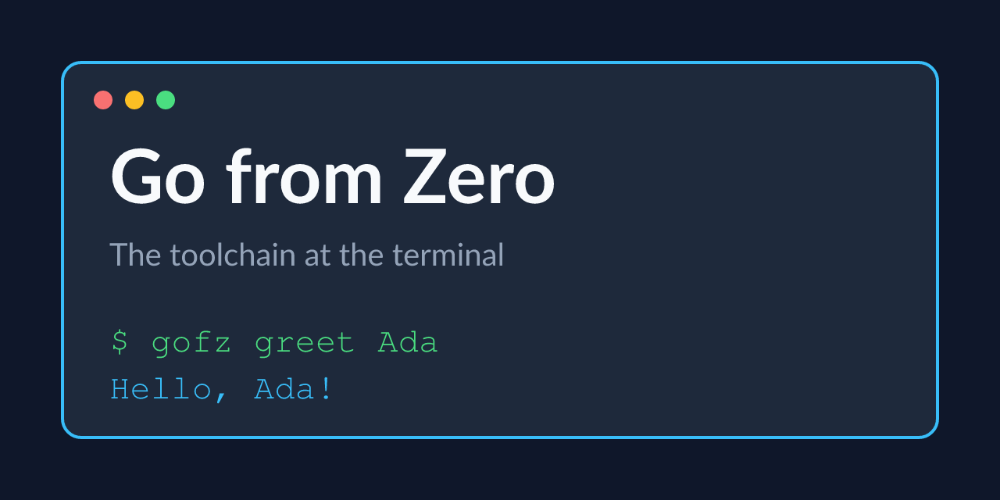

# Go from Zero

The Go toolchain at the terminal, tested to 100%.

Tested Go code for the first course of the Go specialization: modules, vet, tests and a small CLI, each run for real in the terminal.

## Examples

| example | what it does |
|---|---|
| [`examples/gofz`](examples/gofz) | greet, stats and wc, each printing a contract line |

## Prerequisites

- Go 1.21 or newer
- A Linux or macOS terminal

---

Generated — do not edit by hand. Edit `course.toml` and re-render.
